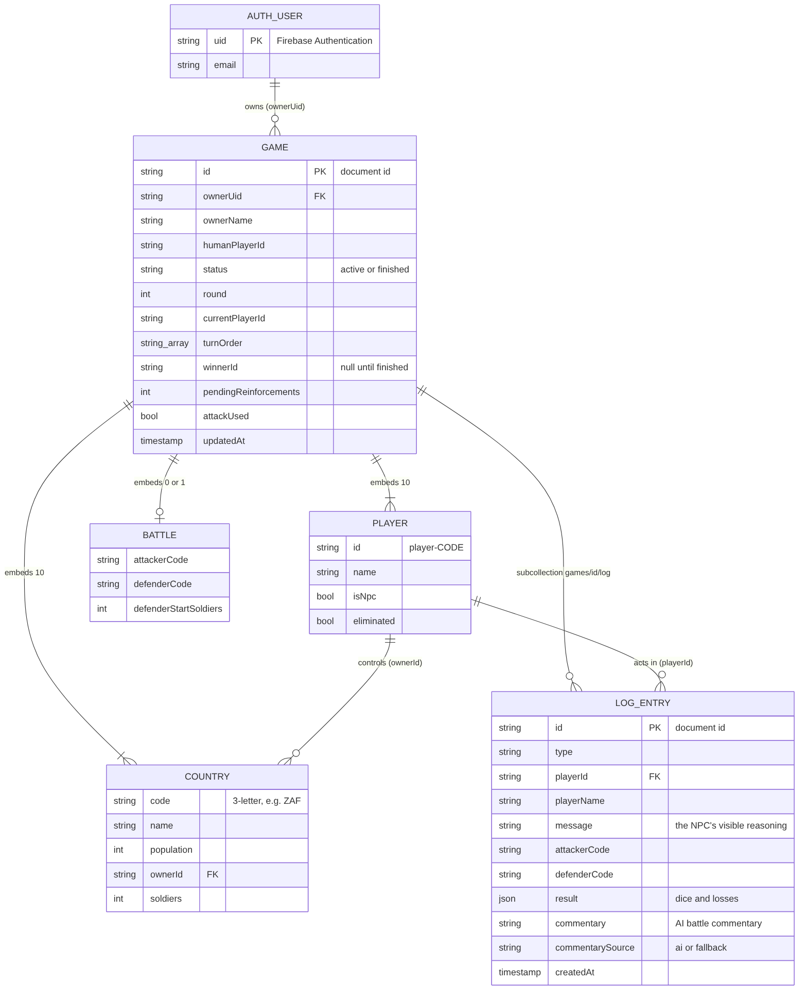
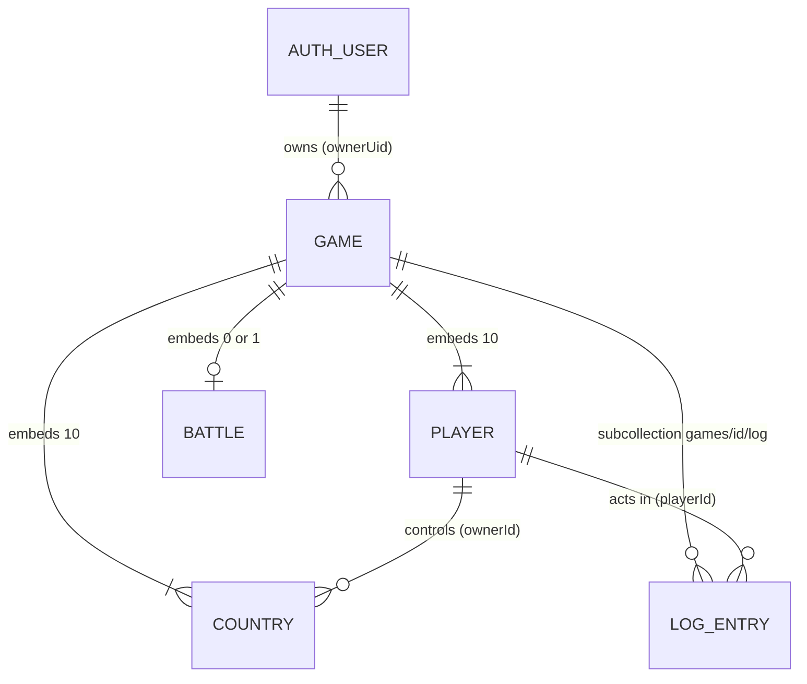

# Database design

The game stores its data in **Cloud Firestore** (a NoSQL document database) and uses
**Firebase Authentication** for accounts.



*(The source of this diagram is [`database-diagram.mmd`](database-diagram.mmd); GitHub also draws it live below.)*



## Why a document database?

* **A game is one natural document.** Everything needed to draw the board (10 countries, 10
  players, whose turn it is) is read together, so one document read replaces what would be
  several joins in SQL.
* **Live viewing is cheap.** Visitors watch a game through one `onSnapshot` listener on one
  document, which updates on every move.
* **The log grows without limit, the game does not.** The log is therefore a *subcollection*:
  appending an event never rewrites the game document and the log can be paged independently.
* **No schema migrations** while the game rules were still changing.

The trade-off is that there are no joins or foreign-key constraints. Relationships are held by
ids (`ownerUid`, `ownerId`, `playerId`) and kept consistent by the game engine and by the
[security rules](#how-the-data-is-protected).

## Collections

There are two: `games` and, inside each game, `log`. Players, countries and the current battle
are *embedded* in the game document because they only make sense as part of one game and are
always read with it.

### `games/{gameId}`

| Field | Type | Meaning |
|---|---|---|
| `ownerUid` | string | Firebase Auth uid of the person who created (and alone may play) the game |
| `ownerName` | string | Display name shown on the games list and leaderboard |
| `humanPlayerId` | string | Id of the human's player, e.g. `player-ZAF`. Never changes |
| `status` | string | `"active"` or `"finished"` |
| `round` | number | Round counter, starts at 1 and goes up by 1 each time every player has played |
| `currentPlayerId` | string | Whose turn it is |
| `turnOrder` | string[] | Player ids in play order (shuffled once at creation, never changes) |
| `winnerId` | string \| null | Winner's player id, `null` until the game is finished |
| `pendingReinforcements` | number | Soldiers the current player must still place (0 in round 1, then 2 per country held) |
| `attackUsed` | boolean | `true` once the current player's one attack for the turn is over |
| `battle` | map \| null | The attack in progress (see below), `null` when there is none |
| `players` | map[] | Exactly 10 entries (see below) |
| `countries` | map[] | Exactly 10 entries (see below) |
| `updatedAt` | timestamp | Last save, used for ordering the games lists and statistics |

**`players[]`**

| Field | Type | Meaning |
|---|---|---|
| `id` | string | `player-` + the country code the player started with |
| `name` | string | Human's name, or `<Country> (NPC)` |
| `isNpc` | boolean | `true` for the nine computer players |
| `eliminated` | boolean | `true` once the player holds no countries |

**`countries[]`**

| Field | Type | Meaning |
|---|---|---|
| `code` | string | Three-letter code, e.g. `ZAF` (also selects the flag) |
| `name` | string | Country name |
| `population` | number | Population, which decides the starting soldiers (1 to 9) |
| `ownerId` | string | `id` of the player who controls it now |
| `soldiers` | number | Current soldiers (a whole number, at least 1 for a held country) |

**`battle`** (only while an attack is in progress)

| Field | Type | Meaning |
|---|---|---|
| `attackerCode` | string | Attacking country |
| `defenderCode` | string | Defending country |
| `defenderStartSoldiers` | number | Defender's soldiers when the battle began; the conquest reward is half of this (minimum 2) |

### `games/{gameId}/log/{entryId}`

One document per visible event: every NPC decision (with its reasoning), every dice round and
every human move.

| Field | Type | Meaning |
|---|---|---|
| `type` | string | `reinforce`, `attack_start`, `battle_round`, `conquered`, `stop_attack`, `transfer`, `skip`, `end_turn` or `victory` |
| `playerId` | string | Who acted |
| `playerName` | string | Their display name at the time |
| `message` | string | The justification shown in the game log, e.g. "about 63% chance to conquer…" |
| `attackerCode`, `defenderCode`, `countryCode`, `from`, `to`, `amount`, `winChance` | various, optional | Details that depend on `type` |
| `result` | map, optional | Dice pairs, losses and outcome of a battle round |
| `commentary` | string, optional | AI battle commentary, added after the entry was written |
| `commentarySource` | string, optional | `"ai"` for model-written text or `"fallback"` for the built-in template |
| `createdAt` | timestamp | Used to keep the log in order |

### Not stored in Firestore

* **Accounts** (`uid`, e-mail, password hash) live in Firebase Authentication.
* **Statistics and the leaderboard** are *calculated* from game documents
  (`src/lib/stats.ts`), so they can never disagree with the games.
* **NPC personalities** are not stored: each NPC's personality is derived from its position in the
  sorted list of NPC ids (`personalityFor` in `NpcStrategy.ts`), so it is the same after a reload.

## How the data is protected

The rules are in [`firestore.rules`](../firestore.rules):

| Who | Read a game or its log | Create a game | Change a game | Delete |
|---|---|---|---|---|
| Visitor (not signed in) | yes | no | no | no |
| Signed-in stranger | yes | only in their own name | no | no |
| Owner | yes | yes | only with a **valid** game step | no |

"A valid game step" means every save is checked against the previous version of the document, so
editing the database directly cannot change soldier counts or ownership:

* soldiers are whole numbers that only appear through reinforcements;
* an enemy country can never gain soldiers;
* a country only changes owner through a conquest by the current player, and with exactly the
  reward the rules allow (at most one conquest per save);
* a player is only marked eliminated when they hold no countries, and cannot come back;
* the turn only moves on with all reinforcements placed, and the next player receives exactly
  `2 × countries held` reinforcements (none in round 1);
* the owner, human player, turn order, country codes and populations never change;
* a game can only be won by holding all 10 countries, and a finished game is frozen;
* log entries can never be edited or deleted; only the AI commentary can be attached.

The same checks exist in TypeScript in [`src/lib/gameWriteRules.ts`](../src/lib/gameWriteRules.ts) and are
unit-tested (`npm test`); the rules file itself is tested against the Firebase emulator
(`npm run test:rules`).

**Limit:** rules cannot re-roll dice, so they cannot prove that a particular dice result was
fair, and because the game engine runs in the browser a determined owner could still choose a
*legal* sequence of moves with luckier dice than random. Making dice authoritative would need a
server (a Cloud Function or API route using the Firebase Admin SDK) that rolls the dice and
writes the result; this is listed under Limitations in the README.

## Deploying the rules

```bash
firebase login
firebase use <your-project-id>
firebase deploy --only firestore:rules
```

or paste the contents of `firestore.rules` into **Firebase console → Firestore Database → Rules**
and press **Publish**.
